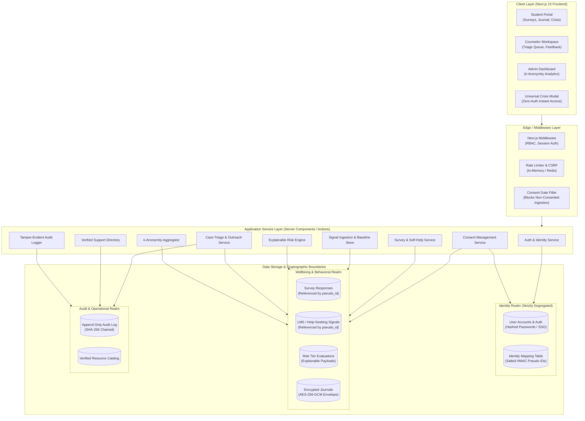
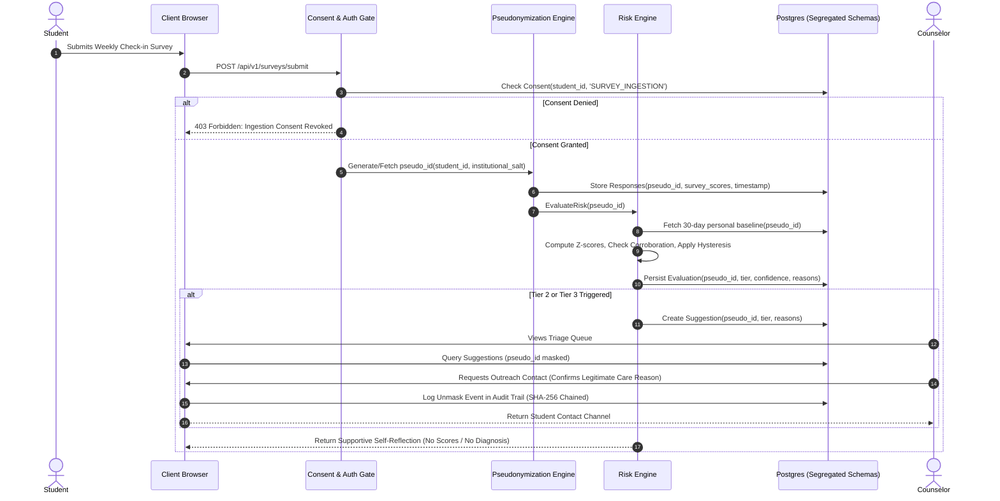

# System & Security Architecture Specification

**Project:** S-12: AI-Based Mental Health Support and Crisis Detection (Sahayak)  
**Document Version:** 1.0.0 (Foundational Architecture)  
**Status:** Approved for Engineering Scaffolding

---

## 1. System Overview & Architecture Principles

Sahayak is architected as a **privacy-first, micro-modular web platform** designed to operate securely within higher education infrastructure. The architecture guarantees cryptographic segregation between personal identity records and behavioral mental health telemetry.

### Core Architectural Pillars

1. **Student-Private, Envelope-Encrypted Decoupling:** Identity attributes (Name, Student ID, Email) and behavioral telemetry (Survey responses, LMS patterns, risk scores) live in distinct database schemas with zero direct foreign key joins in analytics queries.
2. **Honest Decryption & Journal Privacy Model:** Private journal entries and free-form reflections use student-private envelope encryption (AES-256-GCM). Only the authenticated student possessing their session decryption token can decrypt and view their journal text. Neither counselors, nor system administrators, nor database operators have the technical capability to decrypt these entries. Furthermore, journal text is **NEVER** accessed, tokenized, or ingested by the risk-signal engine unless the student explicitly grants a separate, independent opt-in (`consent_journal_signals`, strictly OFF by default).
3. **Defensive API Boundaries:** All inbound and outbound traffic passes through strict Zod schema validation layers, rate limiters, and privacy redactors.
4. **Stateless Explainable Risk Computation:** The risk engine operates deterministically on personal baseline deviations, emitting auditable, human-readable explanations.
5. **Zero-DB Edge Crisis Architecture:** The emergency crisis page (`/crisis`) never touches the database at runtime. It is rendered statically from a build-time validated JSON snapshot (`src/data/support-snapshot.json`) sourced from the verified support directory.
6. **Deployable on Free/Standard Cloud Tiers:** Designed for low footprint and zero operational bloat, fully deployable on platforms like Vercel (Next.js), Neon (Serverless Postgres), and Upstash (Redis rate-limiting).

---

## 2. High-Level Architecture Diagram



---

## 3. Data Flow Diagram & Privacy Boundaries

The following sequence illustrates how signals are ingested, pseudonymized, processed by the risk engine, and surfaced to counselors with strict consent verification.



---

## 4. Technology Stack Selection & Detailed Justification

| Layer              | Selected Tech            | Rationale & Trade-offs                                                                                                                                | Free-Tier Feasibility                                  |
| :----------------- | :----------------------- | :---------------------------------------------------------------------------------------------------------------------------------------------------- | :----------------------------------------------------- |
| **Framework**      | Next.js 15 (React 19)    | Unified full-stack architecture with React Server Components, minimizing API boilerplate and keeping sensitive logic server-side.                     | Deployable on Vercel Hobby tier ($0/mo).               |
| **Language**       | TypeScript 5.6+          | Strict typing prevents type-coercion bugs, essential for privacy flags and mathematical risk engine calculations.                                     | Standard compiler.                                     |
| **Styling & UI**   | Tailwind CSS + shadcn/ui | Unstyled, accessible (Radix UI) primitives allow complete control over color contrast, keyboard navigation, and trauma-informed aesthetics.           | Zero runtime cost.                                     |
| **ORM & Database** | Prisma + PostgreSQL      | Prisma provides schema-level type safety, automated migrations, and support for multi-schema tenancy. PostgreSQL offers JSONB and row-level security. | Compatible with Neon, Supabase, or Railway free tiers. |
| **Authentication** | Auth.js (NextAuth v5)    | Lightweight, standards-compliant session management supporting credentials, magic links, or university SAML/OAuth2.                                   | Zero external licensing cost.                          |
| **Validation**     | Zod 3.23+                | Industry standard for end-to-end schema validation from HTTP inputs down to database writes.                                                          | Lightweight runtime library.                           |
| **Visualizations** | Recharts                 | Accessible SVG charting for personal mood trends and administrator $k$-anonymity charts without external canvas tracking.                             | Client-side bundle.                                    |
| **Testing**        | Vitest + Playwright      | Ultra-fast unit testing with Vitest; end-to-end multi-role browser testing and axe-core accessibility auditing with Playwright.                       | Runs cleanly in local dev and GitHub Actions.          |

---

## 5. Architectural Module Breakdown

### 5.1 Auth & Role-Based Access Control (RBAC)

- **Roles:** `STUDENT`, `COUNSELOR`, `ADMIN`, `SUPER_ADMIN`.
- **Enforcement:** Enforced at Next.js Edge Middleware and reinforced in Server Actions via an authorization wrapper (`requireRole(['COUNSELOR'])`).
- **Session Tokens:** Stateless JWT or database-backed sessions with signed claims containing `userId` and `role`. Identity PII is never placed in client-accessible cookies.

### 5.2 Consent Management Module

- Manages the lifecycle of explicit, granular consent flags:
  1. `consent_surveys`: Permission to store and analyze voluntary check-in surveys.
  2. `consent_academic`: Permission to ingest synthetic/real LMS drift signals.
  3. `consent_help_seeking`: Permission to track resource viewing and booking frequency.
  4. `consent_counselor_triage`: Permission for counselors to see Tier 2/3 check-in suggestions.
  5. `consent_journal_signals`: Permission for risk engine to inspect reflections (strictly default OFF).
- **Revocation Hook:** Triggering revocation immediately invokes the `DataScrubberService`, which sets behavioral records to an anonymized state and clears active alerts.

### 5.3 Survey & Self-Help Module

- Serves adapted, non-diagnostic questionnaires (PHQ-style, GAD-style, Burnout-style).
- Renders immediate self-reflection cards (e.g., _"Grounding exercise suggested for fatigue"_).
- Provides interactive, client-side breathing, mindfulness, and cognitive reframing tools.

### 5.4 Signals Ingestion & Baseline Store

- Ingests three independent signal vectors:
  - **Survey Vector:** Normalized pulse scores $[0.0, 1.0]$.
  - **Academic Vector:** Normalized deadline delays, submission gaps, attendance variance $[0.0, 1.0]$.
  - **Help-Seeking Vector:** Abandoned appointment bookings, late-night help-seeking queries $[0.0, 1.0]$.
- Maintains rolling 30-day personal baseline statistics ($\mu_{\text{student}}$, $\sigma_{\text{student}}$).

### 5.5 Explainable Risk Engine

- Deterministic scoring engine executing the multi-signal corroboration logic.
- Evaluates deviations, applies hysteresis filters to prevent alert oscillation, enforces a 7-day cooldown window, and emits a structured explainability payload.
- Detailed in [RISK_ENGINE.md](./RISK_ENGINE.md).

### 5.6 Case Triage & Counselor Workspace

- Displays active Tier 2 and Tier 3 check-in suggestions.
- Includes a two-step "Reveal Identity" modal that prompts counselors to state an outreach purpose, which is immediately recorded in the immutable audit log.
- Feedback widget enables counselors to rate alert quality (`APPROPRIATE`, `TOO_SENSITIVE`, `NOT_USEFUL`).

### 5.7 Verified Support Directory & Edge Crisis Snapshot

- Stores vetted campus, local, regional, and national crisis resources in `audit_realm.verified_support_resources`.
- **Single Source of Truth:** The database repository is the authoritative source for verified listings.
- **Build-Time Static Snapshot Pipeline:** At build time, an automated script serializes the directory into a validated, immutable JSON snapshot (`src/data/support-snapshot.json`).
- **Zero-DB Emergency Delivery:** The public emergency route (`/crisis`) renders exclusively from this static snapshot with zero authentication and zero database calls, guaranteeing high availability even under database downtime.
- **CI Freshness Gate:** A mandatory CI verification check (`npm run verify:support-snapshot`) asserts that the static snapshot is in sync with the directory and that every entry has a valid, non-expired `verified_on` date.

### 5.8 Institutional Analytics ($k$-Anonymity)

- Calculates aggregate metrics: Average wellbeing index, stress spikes by exam week, resource utilization.
- Implements strict thresholding: If any grouped query yields $N < 10$ unique individuals, the result is suppressed and returned as `k_anonymity_suppressed: true`.

### 5.9 Tamper-Evident Audit Logging

- Records every security-critical action:
  `{ timestamp, actor_id, actor_role, action, target_pseudo_id, metadata, previous_hash, entry_hash }`.
- Creates a cryptographic SHA-256 hash chain preventing retrospective alteration of logs.

---

## 6. Pseudonymization & Cryptographic Architecture

```
+-----------------------------------------------------------------------------------+
|                             IDENTITY BOUNDARY                                     |
|                                                                                   |
|  [Student Real Identity]                                                          |
|  - id: UUID (Primary Key)                                                         |
|  - full_name: "Ananya Sharma"                                                     |
|  - university_email: "ananya.s@campus.edu"                                        |
|  - department: "Computer Science"                                                 |
|                                                                                   |
|                                   │                                               |
|                    HMAC-SHA256(student_id + Salt)                                 |
|                                   ▼                                               |
|                                                                                   |
|  [Pseudonymous Identity Token]                                                    |
|  - student_pseudo_id: "ps_7f9b8c2d1e0a4f5b"                                       |
+-----------------------------------------------------------------------------------+
                                    │
                         Cross-Boundary Isolation
                                    ▼
+-----------------------------------------------------------------------------------+
|                            BEHAVIORAL TELEMETRY                                   |
|                                                                                   |
|  [Surveys, LMS Signals, Risk Tiers, Journal]                                      |
|  - Foreign Key: student_pseudo_id (No direct join to Real Identity)               |
|  - Student-Private Journal: Encrypted via AES-256-GCM Envelope Encryption         |
|  - Risk Engine only ever reads student_pseudo_id                                  |
+-----------------------------------------------------------------------------------+
```

### 6.1 Honest Decryption Model & Envelope Encryption

- **Student-Private Journal Encryption:**
  - Each student is assigned a unique Data Encryption Key (DEK).
  - The DEK is encrypted (wrapped) using the master Key Encryption Key (`APP_MASTER_ENCRYPTION_KEY`).
  - Journal title and contents are encrypted using authenticated `AES-256-GCM` with a fresh 12-byte initialization vector (IV) per entry.
  - **Decryption Access:** The wrapped DEK is unwrapped in server memory only during an active, authenticated student session. Counselors, administrators, and database operators possess no capability or route to decrypt journal entries.
  - **Risk Engine Isolation:** The risk engine **NEVER** inspects, reads, or processes journal content or free-text reflections, unless the student grants an explicit separate opt-in (`consent_journal_signals`, strictly OFF by default).

### 6.2 Pseudonymization Key Management, Rotation & Compromise Response

- **Secret Separation:** The salt secret (`PSEUDO_SALT_SECRET`) is stored in an isolated secret manager (or server environment variable) with zero client exposure.
- **Scheduled Salt Rotation:**
  - Salt rotation occurs annually during academic recess.
  - The rotation script iterates through active users, derives new pseudonymous tokens with the new salt, updates `identity_realm.pseudonym_maps`, and migrates existing `telemetry_realm` foreign keys within an atomic transaction.
- **Key Compromise Emergency Protocol:**
  1. _Immediate Revocation:_ In the event of suspected server environment compromise, the active `PSEUDO_SALT_SECRET` and `APP_MASTER_ENCRYPTION_KEY` are immediately marked compromised.
  2. _Re-Keying Pipeline:_ A migration runner derives new pseudonyms from a fresh secure random secret.
  3. _Audit Verification:_ The cryptographic audit log chain is inspected to detect any unauthorized unmasking queries executed during the suspected breach window.

### 6.3 Small-Cohort Re-Identification & k-Anonymity Protections

In institutional aggregate dashboards, re-identification represents a severe privacy vulnerability if demographic filters yield small cohorts.

- **k-Anonymity Threshold ($k \ge 10$):** Any analytical query grouped by Department, Cohort Year, or Course that returns fewer than 10 unique student records triggers automatic cell suppression.
- **Suppression Mechanism:** The query returns:
  ```json
  {
    "k_anonymity_suppressed": true,
    "cohort_size": "<10",
    "metrics": null,
    "message": "Aggregate metrics suppressed to protect student privacy (cohort size < 10)."
  }
  ```
- **Differentially Private Jitter (Future Path):** Aggregate count queries incorporate Laplace noise ($\epsilon = 0.5$) in multi-cohort comparative views to neutralize differencing attacks across semesters.

---

## 7. API Design Conventions

### 7.1 Standard RESTful Routes

All application endpoints follow predictable REST patterns under `/api/v1`:

| Endpoint                     |     Method     | Role Required | Purpose                                    |
| :--------------------------- | :------------: | :------------ | :----------------------------------------- |
| `/api/v1/auth/session`       |     `GET`      | Public        | Validate session state and claims          |
| `/api/v1/consent`            | `GET` / `PUT`  | `STUDENT`     | Read or update granular consent toggles    |
| `/api/v1/consent/delete-all` |    `DELETE`    | `STUDENT`     | Trigger complete data erasure              |
| `/api/v1/surveys/active`     |     `GET`      | `STUDENT`     | Fetch current active survey questions      |
| `/api/v1/surveys/submit`     |     `POST`     | `STUDENT`     | Ingest survey answers                      |
| `/api/v1/journal`            | `GET` / `POST` | `STUDENT`     | Read/write encrypted journal entries       |
| `/api/v1/support/directory`  |     `GET`      | Public        | Fetch verified support resources           |
| `/api/v1/counselor/queue`    |     `GET`      | `COUNSELOR`   | View active check-in suggestions           |
| `/api/v1/counselor/unmask`   |     `POST`     | `COUNSELOR`   | Reveal contact info for outreach (audited) |
| `/api/v1/counselor/feedback` |     `POST`     | `COUNSELOR`   | Submit alert quality rating                |
| `/api/v1/admin/analytics`    |     `GET`      | `ADMIN`       | Fetch $k$-anonymized aggregate metrics     |
| `/api/v1/admin/audit-logs`   |     `GET`      | `ADMIN`       | Fetch append-only audit trail              |

### 7.2 Standard API Response Envelope

Every API response adheres to a uniform JSON contract:

```typescript
// Success Response
interface ApiSuccessResponse<T> {
  success: true;
  data: T;
  meta?: {
    timestamp: string;
    k_anonymity_applied?: boolean;
    cohort_size?: number;
  };
}

// Error Response
interface ApiErrorResponse {
  success: false;
  error: {
    code: string; // e.g., "CONSENT_REQUIRED", "UNAUTHORIZED"
    message: string; // Human-readable message
    details?: unknown; // Zod validation issues
  };
}
```
