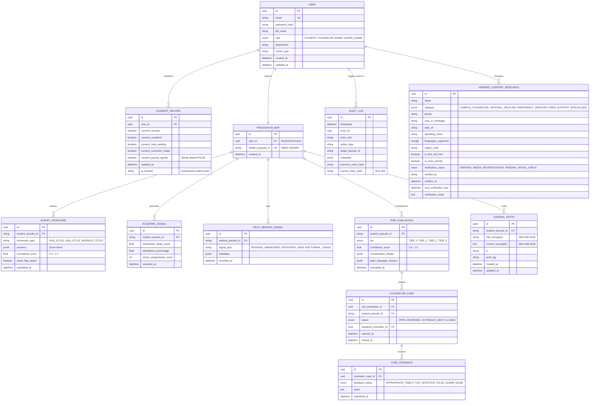

# Database Schema & Data Model Specification

**Project:** S-12: AI-Based Mental Health Support and Crisis Detection (Sahayak)  
**Document Version:** 1.0.0 (Foundational Architecture)  
**Status:** Approved for Engineering Scaffolding

---

## 1. Architectural Schema Segregation

To guarantee privacy by design, the database is partitioned into three logical schemas (or isolated database realms):

1. **`identity_realm`**: Holds user accounts, credentials, and real-world identifying PII.
2. **`telemetry_realm`**: Holds all behavioral signals, survey responses, journal entries, and risk computations, keyed solely by `student_pseudo_id`.
3. **`audit_realm`**: Holds append-only, tamper-evident audit logs and the verified support directory.

---

## 2. Entity-Relationship Diagram (Mermaid)

---

## 3. Detailed Table Specifications & Privacy Attributes

### 3.1 `identity_realm.users`

_Holds real identity information. Strictly restricted from regular analytics queries._

- `id`: `UUID` (Primary Key).
- `email`: `VARCHAR(255)` (Unique, Indexed).
- `password_hash`: `VARCHAR(255)` (Argon2id or bcrypt).
- `full_name`: `VARCHAR(255)` (PII).
- `role`: `ENUM('STUDENT', 'COUNSELOR', 'ADMIN', 'SUPER_ADMIN')`.
- `department`: `VARCHAR(100)` (e.g., "Computer Science").
- `cohort_year`: `VARCHAR(10)` (e.g., "2026").
- `created_at`: `TIMESTAMP WITH TIME ZONE`.
- _Privacy Classification:_ **Confidential PII**. Access limited to Auth service and audited counselor unmasking.

### 3.2 `identity_realm.pseudonym_maps`

_The cryptographic bridge between real user IDs and pseudonymous telemetry._

- `id`: `UUID` (Primary Key).
- `user_id`: `UUID` (Foreign Key to `users.id`, Unique).
- `student_pseudo_id`: `VARCHAR(64)` (Unique, Indexed, generated via `HMAC_SHA256(user_id, PSEUDO_SALT_SECRET)`).
- `created_at`: `TIMESTAMP WITH TIME ZONE`.
- _Privacy Classification:_ **Cryptographic Isolation Boundary**. Direct SQL joins against this table are disallowed in API route controllers except in audited unmasking actions.

### 3.3 `identity_realm.consent_records`

_Granular opt-in toggles controlling background processing._

- `id`: `UUID` (Primary Key).
- `user_id`: `UUID` (Foreign Key to `users.id`, Unique).
- `consent_surveys`: `BOOLEAN` (Default: `FALSE`).
- `consent_academic`: `BOOLEAN` (Default: `FALSE`).
- `consent_help_seeking`: `BOOLEAN` (Default: `FALSE`).
- `consent_counselor_triage`: `BOOLEAN` (Default: `FALSE`).
- `consent_journal_signals`: `BOOLEAN` (Default: `FALSE`, strictly separate opt-in allowing risk engine analysis of reflections).
- `emergency_escalation_acknowledged`: `BOOLEAN` (Default: `FALSE`).
- `updated_at`: `TIMESTAMP WITH TIME ZONE`.
- _Privacy Classification:_ **Legal Consent Audit Record**. Retention: Duration of user account.

### 3.4 `telemetry_realm.survey_responses`

_Voluntary pulse checks submitted by students._

- `id`: `UUID` (Primary Key).
- `student_pseudo_id`: `VARCHAR(64)` (Foreign Key).
- `instrument_type`: `VARCHAR(50)` (e.g., `"PHQ_STYLE"`, `"GAD_STYLE"`, `"BURNOUT_STYLE"`).
- `answers`: `JSONB` (Array of question IDs and numeric choices 1-5).
- `normalized_score`: `FLOAT` ($0.0 \le s \le 1.0$).
- `acute_flag_raised`: `BOOLEAN` (Indicates acute distress answer, e.g., self-harm ideation).
- `submitted_at`: `TIMESTAMP WITH TIME ZONE`.
- _Privacy Classification:_ **Sensitive Wellbeing Telemetry**. Retention: 90 days rolling window.

### 3.5 `telemetry_realm.academic_signals`

_LMS-derived indicators reflecting workload and deadlines relative to student baseline._

- `id`: `UUID` (Primary Key).
- `student_pseudo_id`: `VARCHAR(64)` (Foreign Key).
- `submission_delay_hours`: `FLOAT` (Hours past official deadline).
- `attendance_percentage`: `FLOAT` (Attendance rate over recent period).
- `active_assignments_count`: `INTEGER` (Workload clustering count).
- `recorded_at`: `TIMESTAMP WITH TIME ZONE`.
- _Privacy Classification:_ **Behavioral Telemetry**. Retention: 60 days rolling window.

### 3.6 `telemetry_realm.help_seeking_signals`

_Interaction signals with campus wellness tools._

- `id`: `UUID` (Primary Key).
- `student_pseudo_id`: `VARCHAR(64)` (Foreign Key).
- `signal_type`: `ENUM('BOOKING_ABANDONED', 'RESOURCE_VIEW', 'NOCTURNAL_USAGE')`.
- `metadata`: `JSONB` (Non-PII context: e.g., `{ time_of_day: "03:15", duration_sec: 240 }`).
- `recorded_at`: `TIMESTAMP WITH TIME ZONE`.
- _Privacy Classification:_ **Behavioral Telemetry**. Retention: 30 days rolling window.

### 3.7 `telemetry_realm.risk_evaluations`

_Outputs of the explainable risk engine._

- `id`: `UUID` (Primary Key).
- `student_pseudo_id`: `VARCHAR(64)` (Foreign Key).
- `tier`: `ENUM('TIER_0', 'TIER_1', 'TIER_2', 'TIER_3')`.
- `confidence_score`: `FLOAT` ($0.0 \le c \le 1.0$).
- `corroboration_details`: `JSONB` (Indicates which signal families corroborated).
- `plain_language_reasons`: `JSONB` (Array of human-readable non-diagnostic explanation strings).
- `evaluated_at`: `TIMESTAMP WITH TIME ZONE`.
- _Privacy Classification:_ **Algorithmic Evaluation Record**. Retention: 90 days.

### 3.8 `telemetry_realm.journal_entries`

_Student private reflections with envelope encryption._

- `id`: `UUID` (Primary Key).
- `student_pseudo_id`: `VARCHAR(64)` (Foreign Key).
- `title_encrypted`: `TEXT` (AES-256-GCM ciphertext in base64).
- `content_encrypted`: `TEXT` (AES-256-GCM ciphertext in base64).
- `iv`: `VARCHAR(32)` (Initialization Vector).
- `auth_tag`: `VARCHAR(32)` (Authentication Tag).
- `created_at`: `TIMESTAMP WITH TIME ZONE`.
- `updated_at`: `TIMESTAMP WITH TIME ZONE`.
- _Privacy Classification:_ **Student-Private, Envelope-Encrypted Data**. Decryptable only in server memory during an active, authenticated student session using the user's unwrapped Data Encryption Key (DEK). Counselors, admins, and database operators have zero decryption ability. Journals and free text are **NEVER** used, analyzed, or tokenized by the risk engine unless the student provides a separate, explicit opt-in (`consent_journal_signals`, default: `FALSE`).

### 3.9 `telemetry_realm.counselor_cases`

_Triage queue entries visible to authorized counselors._

- `id`: `UUID` (Primary Key).
- `risk_evaluation_id`: `UUID` (Foreign Key).
- `student_pseudo_id`: `VARCHAR(64)` (Foreign Key).
- `status`: `ENUM('OPEN', 'REVIEWED', 'OUTREACH_SENT', 'CLOSED')`.
- `assigned_counselor_id`: `UUID` (Nullable, references `users.id`).
- `opened_at`: `TIMESTAMP WITH TIME ZONE`.
- `closed_at`: `TIMESTAMP WITH TIME ZONE` (Nullable).

### 3.10 `telemetry_realm.case_feedback`

_Feedback loop to minimize false alarms and calibrate engine weights._

- `id`: `UUID` (Primary Key).
- `counselor_case_id`: `UUID` (Foreign Key).
- `feedback_rating`: `ENUM('APPROPRIATE_TIMELY', 'TOO_SENSITIVE', 'FALSE_ALARM_NOISE')`.
- `notes`: `TEXT` (Nullable, non-PII notes on signal accuracy).
- `submitted_at`: `TIMESTAMP WITH TIME ZONE`.

### 3.11 `audit_realm.audit_logs`

_Cryptographically chained immutable audit records._

- `id`: `UUID` (Primary Key).
- `timestamp`: `TIMESTAMP WITH TIME ZONE`.
- `actor_id`: `UUID` (References acting user).
- `actor_role`: `VARCHAR(50)`.
- `action_type`: `VARCHAR(100)` (e.g., `UNMASK_STUDENT_IDENTITY`, `CONSENT_REVOKED`, `DATA_ERASURE`).
- `target_pseudo_id`: `VARCHAR(64)` (Nullable).
- `metadata`: `JSONB` (Context, reason provided by counselor).
- `previous_entry_hash`: `VARCHAR(64)` (SHA-256 of preceding audit record).
- `current_entry_hash`: `VARCHAR(64)` (SHA-256 of current record concatenated with previous hash).

### 3.12 `audit_realm.verified_support_resources`

_Authoritative catalog of verified support contacts and emergency hotlines._

- `id`: `UUID` (Primary Key).
- `name`: `VARCHAR(255)`.
- `category`: `ENUM('CAMPUS_COUNSELING', 'NATIONAL_HELPLINE', 'EMERGENCY_SERVICES', 'PEER_SUPPORT', 'SPECIALIZED')`.
- `description`: `TEXT`.
- `phone`: `VARCHAR(50)` (E.164 or national shortcode).
- `sms_or_whatsapp`: `VARCHAR(50)` (Nullable).
- `web_url`: `VARCHAR(255)`.
- `operating_hours`: `VARCHAR(100)`.
- `languages_supported`: `TEXT[]`.
- `region_code`: `VARCHAR(20)`.
- `is_free_toll_free`: `BOOLEAN`.
- `is_crisis_priority`: `BOOLEAN`.
- `verification_status`: `ENUM('VERIFIED', 'NEEDS_REVERIFICATION', 'PENDING_INITIAL_CHECK')`.
- `verified_by`: `VARCHAR(255)`.
- `verified_on`: `TIMESTAMP WITH TIME ZONE`.
- `next_verification_due`: `TIMESTAMP WITH TIME ZONE`.
- `verification_notes`: `TEXT`.
- _Privacy Classification:_ **Public Verified Directory**. Single source of truth compiled at build-time to `src/data/support-snapshot.json`.

---

## 4. Realistic Synthetic Seed Data Plan

To ensure testability and robust hackathon demonstration without risking real student health data, the system includes a realistic, pre-calibrated **Synthetic Seed Generator**.

### Seed Cohort Architecture:

- **Total Simulated Students:** 50
- **Tier Distribution:**
  - **Tier 0 (Thriving):** 35 students (Healthy baseline variance, stable submissions, regular sleep).
  - **Tier 1 (Watch):** 8 students (Single-vector drift, e.g., exams week fatigue or isolated deadline delay).
  - **Tier 2 (Gentle Check-in Suggested):** 5 students (Corroborated 2-signal drift, e.g., low mood survey + 3 late assignments).
  - **Tier 3 (Priority Human Review):** 2 students (Acute distress indicator or multi-vector severe spike with nocturnal help-seeking).
- **Staff Accounts:**
  - 1 Lead Counselor (`counselor@campus.edu`)
  - 1 Institutional Administrator (`admin@campus.edu`)
  - 3 Diverse Demo Student Personas (`ananya@campus.edu`, `rohit@campus.edu`, `priya@campus.edu`)
- **Support Directory Entries:** 12 curated entries (Campus clinic, Tele-MANAS, KIRAN, Vandrevala Foundation, Crisis Text Line) all marked with explicit `VERIFY BEFORE LAUNCH` review stamps.
