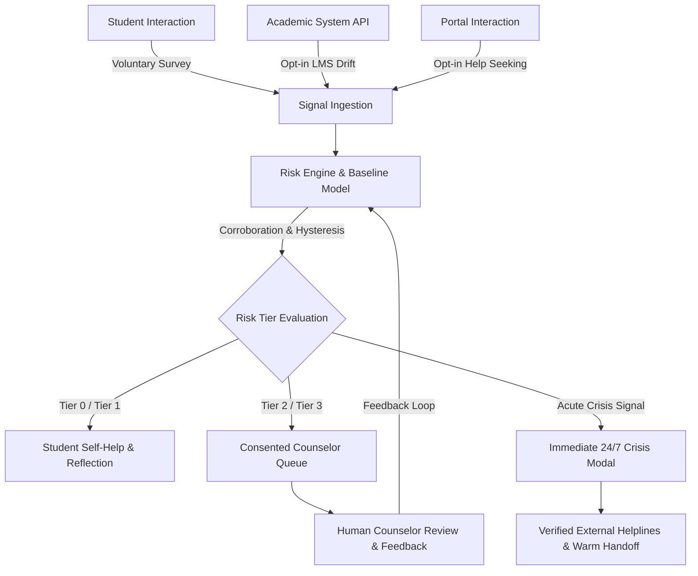

# Product Requirements Document (PRD)

**Project:** S-12: AI-Based Mental Health Support and Crisis Detection  
**Working Title:** Sahayak (Configurable Institutional Wellness Platform)  
**Document Version:** 1.0.0 (Foundational Architecture)  
**Status:** Approved for Engineering Scaffolding  
**Lead Authors:** Senior Staff Engineer, Lead Product Designer, Privacy & Ethics Lead

---

## 1. Executive Summary & Vision

### 1.1 Vision Statement

Higher education environments place unprecedented cognitive, psychological, and social stress on students. Traditional campus mental health frameworks are fundamentally reactive: students must experience severe impairment or crisis before reaching out, often facing social stigma, long waiting lists, and opaque triage.

**Sahayak** is a proactive, privacy-preserving, early-signal wellbeing platform. It bridges the critical gap between early unaddressed distress and emergency crisis intervention. By analyzing voluntary check-ins, consented academic drift, and help-seeking behavioral patterns against a student's own baseline, Sahayak provides compassionate, actionable self-help insights to students and early, non-diagnostic check-in suggestions to university counselors—all while rigorously protecting student anonymity and civil liberties.

### 1.2 Problem Statement (Verbatim)

> "Develop a privacy-preserving platform that identifies students at risk of severe stress, burnout, or self-harm using voluntary surveys, academic patterns, and help-seeking behavior. Detect risk without diagnosis, protect privacy, minimize false alarms, and connect students to verified support."

### 1.3 Core Product Philosophy: What Sahayak Is and Is NOT

| What Sahayak IS                                                   | What Sahayak IS NOT                                      |
| :---------------------------------------------------------------- | :------------------------------------------------------- |
| An **early-warning signal companion** for student self-reflection | A clinical diagnostic tool or psychiatric medical device |
| A **consented, voluntary, student-controlled** private space      | An institutional surveillance or proctoring system       |
| A **decision-support tool** for human counselors                  | An automated dispatch or disciplinary reporting engine   |
| An **instant gateway** to verified 24/7 human crisis support      | An AI chatbot pretending to replace qualified therapy    |
| A system measuring **change against personal baseline**           | A normative ranking or grading of student mental health  |

---

## 2. Product Goals & Non-Goals

### 2.1 Primary Goals

1. **Early Signal Detection Without Diagnosis:** Identify statistically meaningful shifts in stress, burnout, and distress using multi-signal corroboration before acute crises emerge.
2. **Absolute Privacy Preservation:** Decouple student identity from behavioral signals through pseudonymization, student-private envelope-encrypted principles, and strict $k$-anonymity ($k \ge 10$) on all aggregate reporting.
3. **Minimizing False Alarms:** Prevent alert fatigue and student distress by requiring cross-signal corroboration, hysteresis, cooldown windows (applicable strictly to passive signals; acute self-reports bypass both), and continuous counselor feedback calibration.
4. **Immediate Crisis Safety Connection:** Provide one-tap, unhindered access to verified regional and national emergency resources across every application screen.
5. **Culturally Grounded and Accessible:** Offer multilingual support (English, Hindi, Bengali) with trauma-informed, low-cognitive-load, WCAG 2.2 AA accessible design.

### 2.2 Non-Goals

1. **No Psychiatric Diagnoses:** The system will never compute DSM-5 or ICD-11 diagnostic classifications (e.g., "Major Depressive Disorder", "Panic Disorder").
2. **No Automated Punitive or Administrative Action:** Never trigger involuntary leaves of absence, academic probation, or parental notification automatically.
3. **No Coerced Surveillance:** The system will never scrape private student communications, social media, webcam feeds, keystrokes, or ambient device telemetry.
4. **No Replacement for Certified Clinical Therapy:** The platform facilitates warm handoffs to humans; it does not prescribe medications, psychotherapeutic regimes, or medical interventions.

---

## 3. Success Metrics & Key Performance Indicators (KPIs)

| Metric                           | Target (MVP / Pilot) | Target (Production Year 1) | Measurement Method                                                                   |
| :------------------------------- | :------------------- | :------------------------- | :----------------------------------------------------------------------------------- |
| **Tier 3 Alert Precision**       | $\ge 80\%$           | $\ge 88\%$                 | Counselor feedback: % of Tier 3 reviews marked "Actionable / Clinically Appropriate" |
| **False-Alarm Rate**             | $< 15\%$             | $< 8\%$                    | Counselor feedback: % of alerts marked "Not Useful / Noise"                          |
| **Student Voluntary Opt-in**     | $\ge 40\%$ cohort    | $\ge 65\%$ cohort          | Consent service telemetry: % of eligible campus students enrolled                    |
| **Time-to-Support Connection**   | $< 3$ seconds        | $< 1$ second               | Telemetry: latency from crisis tap to verified helpline display/dialer               |
| **System Usability Scale (SUS)** | $\ge 82$ (Grade A)   | $\ge 88$ (Grade A+)        | Bi-annual anonymous student UX survey                                                |
| **Platform P95 Latency**         | $< 250\text{ ms}$    | $< 150\text{ ms}$          | Synthetic API monitoring on check-in and dashboard endpoints                         |
| **Privacy Compliance Audit**     | $100\%$ pass         | $100\%$ pass               | Automated privacy regression tests ($k \ge 10$, zero PII leaks in logs)              |

---

## 4. User Personas & Detailed Journeys

### 4.1 Persona 1: Ananya Sharma (Undergraduate Engineering Student)

- **Background:** 20-year-old 3rd-year Computer Science student living away from home. Facing heavy coursework, competitive placement exams, and disrupted sleep patterns.
- **Pain Points:** Afraid of seeking counseling due to fear that the university will notify parents or that it will appear on her academic record. Feeling overwhelmed, skipping meals, and falling behind on submissions.
- **Goals:** Wants a safe, private place to track her mood, understand why she feels exhausted, and explore self-care exercises without feeling judged or labeled.
- **User Journey:**
  1. _Discovery & Onboarding:_ Receives campus welcome link. Transparently reviews 3 separate consent toggles (Surveys, Academic Drift, Help-Seeking Patterns). Opts into Surveys and Help-Seeking; leaves Academic Drift off initially.
  2. _Regular Check-in:_ Completes a 2-minute weekly pulse check. Notes mild burnout and sleep disruption. Reads an encouraging, non-stigmatizing summary: _"Your sleep scores indicate high fatigue compared to last month. Here are 3 science-backed grounding routines."_
  3. _Distress Spike:_ During finals, Ananya's check-in responses indicate elevated distress. The system corroborates this with late-night portal access. A gentle prompt appears: _"Things seem heavier than usual this week. Would you like to speak confidentially with a peer counselor or professional?"_
  4. _Support Linkage:_ Ananya clicks "Talk to Someone", sees the campus counseling hours, and books a confidential slot with one tap.

### 4.2 Persona 2: Dr. Vikram Malhotra (Lead Campus Counselor)

- **Background:** Senior licensed clinical psychologist leading a team of 4 campus counselors serving 8,000 students.
- **Pain Points:** Overwhelmed by crisis walk-ins at the end of semesters. High rate of preventable dropouts. Lack of early indicators before students reach acute crisis.
- **Goals:** Needs an organized, prioritized triage queue of consented students who may benefit from gentle check-in outreach, with plain-language explanations of why the alert triggered.
- **User Journey:**
  1. _Queue Review:_ Dr. Malhotra logs in via SSO with hardware MFA. Views the "Suggested Check-ins" queue.
  2. _Case Inspection:_ Clicks on a Tier 2 suggestion for Student #A4F9 (consented student). Sees: _"Multi-signal alert: Survey indicates elevated exhaustion (+2.1σ vs personal baseline) corroborated by 3 abandoned counselor booking attempts in the past 48h."_
  3. _Human Outreach Decision:_ Decides to send a pre-approved, supportive outreach email: _"Hi Ananya, I'm reaching out from student wellness just to see how your semester is going. No obligation at all, but my door is open for a cup of tea."_
  4. _Feedback Logging:_ Dr. Malhotra marks the alert as _"Appropriate & Timely"_, reinforcing the false-alarm minimization calibration.

### 4.3 Persona 3: Prof. Sunita Rao (Dean of Student Affairs / Administrator)

- **Background:** University administrator responsible for student welfare policy, mental health budgets, and institutional compliance (DPDP Act 2023, UGC guidelines).
- **Pain Points:** Needs macro-level data to justify budget allocation for counselors and wellness initiatives, but cannot and must not see individual student health records.
- **Goals:** Wants anonymized, aggregated population trends to identify systemic stress peaks across departments and terms while guaranteeing zero re-identification risk.
- **User Journey:**
  1. _Admin Login:_ Authenticates with Administrator credentials.
  2. _Aggregate Trends View:_ Accesses the Wellbeing Analytics Dashboard. Filters by Department ("Electrical Eng") and Academic Year ("Year 2").
  3. _Differential Privacy & k-Anonymity:_ Views a trend line showing elevated burnout signals across the cohort during Midterm Week 7. Notice indicates: _"Cohort size: 142 students ($k \ge 10$ satisfied). Data is fully anonymized."_
  4. _Resource Management:_ Verifies that all 14 entries in the Verified Support Directory have up-to-date verification dates and contact protocols.

---

## 5. Functional Requirements & Feature Specification (MoSCoW)



### 5.1 Must-Have Features (M - Non-Negotiable for MVP)

#### M1: Granular Consent & Privacy Center

- **Description:** Complete user control over data sharing categories.
- **Acceptance Criteria:**
  - Independent boolean toggles for: (1) Voluntary Wellbeing Surveys, (2) Academic Drift Indicators, (3) Help-Seeking Patterns, and (4) Emergency Protocol Acknowledgement.
  - Revoking any toggle immediately terminates background signal processing for that domain and triggers soft-deletion/anonymization within 60 seconds.
  - Clear, plain-language explanation of what each toggle does with zero dark patterns.

#### M2: Voluntary Wellbeing Pulse Surveys

- **Description:** Short, clinically grounded check-in instruments adapted from validated scales (PHQ-style depression items, GAD-style anxiety items, Maslach-style burnout items).
- **Acceptance Criteria:**
  - Original wording used to ensure ethical compliance; explicit academic citations provided.
  - Results displayed to students using positive, supportive language (e.g., "Reflective Summary: Energy levels low this week").
  - Absolute ban on clinical labels or diagnostic scores shown to users.

#### M3: Multi-Signal Risk & Corroboration Engine

- **Description:** Deterministic, explainable scoring engine evaluating personal baseline deviations.
- **Acceptance Criteria:**
  - Computes deviations against the student's _own_ rolling baseline ($\mu$ and $\sigma$ over previous 30 days), rather than a rigid population-wide threshold.
  - Enforces the **Corroboration Rule**: Tier 2 (Gentle Check-in Suggested) and Tier 3 (Priority Human Review) require at least two distinct signal categories (e.g., Survey + Academic, or Survey + Help-Seeking).
  - Enforces **Hysteresis & Cooldowns**: Once an alert triggers, repeated alerts are suppressed for 7 days unless acute risk language is detected.
  - Every alert generates an explainability payload: `{ tier, confidence, reasons: string[] }`.

#### M4: Counselor Suggested Check-in Queue

- **Description:** Triage workspace for authorized wellbeing personnel.
- **Acceptance Criteria:**
  - Displays only students who have explicitly opted into counselor triage and triggered Tier 2 or Tier 3 signals.
  - Student identity is masked by default with pseudonymous avatar/token; counselor can reveal student contact info only after confirming legitimate care outreach reason (logged in audit table).
  - Includes a one-click alert quality feedback loop: _"Useful / Actionable"_ or _"False Alarm / Noise"_.

#### M5: Verified Support Directory & 24/7 Crisis Safety Path

- **Description:** Dynamic, region-configurable directory of certified mental health resources and zero-click emergency access.
- **Acceptance Criteria:**
  - Every screen features a persistent, high-contrast, accessible "Get Help Now" button.
  - Clicking "Get Help Now" opens the Crisis Modal in $<100\text{ ms}$ with zero authentication barrier.
  - Directory entries store `verified_by`, `verification_date`, `next_review_due`, `phone`, `operating_hours`, `languages_supported`, and `region`.
  - Placeholders marked `VERIFY BEFORE LAUNCH`.

#### M6: Institutional Aggregate Analytics ($k \ge 10$)

- **Description:** Macro-level dashboard for university leadership.
- **Acceptance Criteria:**
  - Visualizes aggregate wellness trends over time by department, cohort, and academic term.
  - Enforces a strict filter: any slice with $<10$ students is automatically redacted (`[Cohort too small for privacy]`).

#### M7: Tamper-Evident Audit Logging

- **Description:** Complete traceability of sensitive actions.
- **Acceptance Criteria:**
  - Every counselor identity unmasking, consent modification, data export, and admin configuration change is recorded with timestamp, actor pseudonymous ID, action, and cryptographic SHA-256 hash chaining.

### 5.2 Should-Have Features (S - Required for Full Pilot)

- **S1: Private Encrypted Reflection Journal:** End-to-end encrypted personal notes for students with local-first or client-side encrypted storage.
- **S2: Academic Drift Ingestion (Simulated LMS Connector):** Ingestion adapter for attendance drops, late submissions, and workload spikes.
- **S3: Multilingual Localization:** Full string localization in English, Hindi, and Bengali with RTL/LTR validation and cultural phrasing nuance.
- **S4: Self-Help Toolkit:** Library of breathing exercises, grounding techniques, cognitive reframing guides, and sleep hygiene modules.

### 5.3 Could-Have Features (C - Future Roadmap / Hackathon Enhancements)

- **C1: Offline PWA Support:** Progressive Web App capabilities for accessing self-help grounding exercises and crisis phone numbers without internet connectivity.
- **C2: Peer Support Community Matching:** Anonymized peer buddy pairing based on shared academic challenges.

### 5.4 Won't-Have (W - Explicitly Excluded)

- **W1:** Automated emergency services calling (e.g., auto-dialing 112/911 without student action).
- **W2:** Automated notifications to parents, guardians, academic supervisors, or landlords.
- **W3:** Facial emotion recognition via camera or voice stress analysis via microphone.
- **W4:** Machine learning models operating as black-box diagnostic arbiters.

---

## 6. User Stories (Agile Form)

| ID        | As a...       | I want to...                                                  | So that...                                                                             |
| :-------- | :------------ | :------------------------------------------------------------ | :------------------------------------------------------------------------------------- |
| **US-01** | Student       | View and adjust my consent settings at any time               | I retain full control over which aspects of my data are analyzed.                      |
| **US-02** | Student       | Complete a quick 2-minute weekly check-in                     | I can reflect on my stress levels and receive personalized grounding tools.            |
| **US-03** | Student       | Access crisis resources instantly from any page               | I can find immediate help during an acute mental health episode without delay.         |
| **US-04** | Student       | Write in a private journal                                    | I can process my thoughts knowing my notes are encrypted and invisible to anyone else. |
| **US-05** | Counselor     | View a prioritized list of suggested check-ins                | I can proactively reach out to students showing multi-signal distress patterns.        |
| **US-06** | Counselor     | See a plain-language explanation of why a student was flagged | I understand their specific stress context before initiating compassionate contact.    |
| **US-07** | Counselor     | Provide feedback on whether an alert was clinically useful    | The system continuously refines its sensitivity and minimizes false alarms.            |
| **US-08** | Administrator | View anonymized, cohort-level stress trends ($k \ge 10$)      | I can allocate counseling resources effectively during high-pressure exam weeks.       |
| **US-09** | Administrator | Manage and verify the campus support directory                | Students always have access to verified, working telephone and crisis contacts.        |
| **US-10** | Student       | Permanently delete all my stored data                         | I can leave the platform with confidence that my digital footprint is purged.          |

---

## 7. Non-Functional Requirements (NFRs)

### 7.1 Privacy & Data Protection

- **DPDP Act 2023 (India) Compliance:** All student personal data processing is backed by unambiguous, affirmative consent with documented withdrawal workflows.
- **FERPA & GDPR Awareness:** Health and academic data are decoupled; educational records are not commingled with psychological indicators; right to erasure is built into the core API.
- **Zero Third-Party Leaks:** No external trackers, web analytics pixels, or CDNs that log student IP addresses.

### 7.2 Security Architecture

- **Encryption at Rest:** AES-256 for all relational data; field-level envelope encryption for sensitive survey text and journal entries.
- **Encryption in Transit:** TLS 1.3 enforced with strict HSTS, secure cookies (`SameSite=Strict`, `HttpOnly`, `Secure`).
- **Authentication & RBAC:** Role-Based Access Control enforced at middleware and database query boundaries. Multi-Factor Authentication (MFA) supported for Counselor and Admin tiers.

### 7.3 Accessibility (WCAG 2.2 Level AA)

- **Visual Contrast:** Minimum contrast ratio of 4.5:1 for standard text and 3:0:1 for graphical elements.
- **Keyboard Operability:** 100% of workflows executable via keyboard; visible, high-contrast focus indicators.
- **Screen Reader Support:** Semantic HTML5, ARIA labels, live regions for crisis notifications.
- **Trauma-Informed Sensory UX:** Respects `prefers-reduced-motion`; no flashing banners, jarring red alert sirens, or anxiety-inducing countdown timers.

### 7.4 Performance & Scalability

- **Response Times:** P95 response time $<250\text{ ms}$ on interactive student flows; $<100\text{ ms}$ on crisis hotlines.
- **Reliability:** 99.9% uptime for core crisis directory and student self-help endpoints.

### 7.5 Internationalization (i18n)

- **Supported Languages:** English (default), Hindi (हिंदी), and Bengali (বাংলা).
- **Culturally Sensitive Translation:** Mental health terminology translated into culturally respectful, non-stigmatizing idioms vetted by bilingual wellness practitioners.

---

## 8. Risk Assessment & Mitigations

| Risk Category   | Specific Risk Description                                      |  Impact  | Probability | Mitigation Strategy                                                                                                           |
| :-------------- | :------------------------------------------------------------- | :------: | :---------: | :---------------------------------------------------------------------------------------------------------------------------- |
| **Ethical**     | Stigmatization or discrimination if a student is flagged.      |   High   |     Low     | Absolute ban on sharing flags with faculty, grades, or disciplinary committees; pseudonymous counselor queues.                |
| **Clinical**    | False negatives: A student in severe distress is not flagged.  | Critical |     Med     | Universal, persistent crisis access on all screens; educational copy reminding users to never wait for an alert to seek help. |
| **Operational** | Alert fatigue: Counselors receive excessive false alarms.      |   Med    |     Med     | Corroboration rule (2+ signal families), personal baseline deviations (Z-score), cooldown periods, counselor feedback loop.   |
| **Legal**       | Non-compliance with DPDP Act 2023 or local data sovereignty.   |   High   |     Low     | Granular opt-in consent, instant deletion API, zero cross-border transfer of PII, comprehensive privacy impact assessment.    |
| **Technical**   | Re-identification of students in small departments or cohorts. |   High   |     Low     | Strict $k$-anonymity threshold ($k \ge 10$); suppression of demographic filters if subgroup size is below threshold.          |

> **Legal Disclaimer:** _This document and the associated system architecture do not constitute legal or clinical medical advice. Institutional deployment requires formal review by university legal counsel and licensed psychological advisory boards._

---

## 9. MVP Hackathon Scope vs. Post-Hackathon Roadmap

```
+-------------------------------------------------------------------+
|                        HACKATHON MVP SCOPE                        |
+-------------------------------------------------------------------+
| • 3 Role Authentication (Student, Counselor, Admin)               |
| • Granular 4-Way Consent Management Center                        |
| • Adapted Pulse Surveys (PHQ/GAD/Burnout style, non-diagnostic)   |
| • Synthetic Signal Simulator (LMS drift + Help-seeking patterns)  |
| • Explainable Corroborated Risk Engine (Tiers 0-3, Z-scores)      |
| • Counselor Queue with Feedback Loop & Unmasking Audit Log        |
| • Persistent 24/7 Crisis Safety Modal & Verified Support Directory|
| • Admin Aggregate Analytics with k >= 10 Anonymity Enforcement     |
| • Multilingual UI Mockup (English, Hindi, Bengali)                |
+-------------------------------------------------------------------+
                                 │
                                 ▼
+-------------------------------------------------------------------+
|                       POST-HACKATHON ROADMAP                      |
+-------------------------------------------------------------------+
| • Real-time LMS LTI 1.3 integrations (Canvas, Moodle, Blackboard) |
| • End-to-end client-side encrypted WebCrypto Journal sync        |
| • On-device, edge-computed privacy-preserving ML scoring          |
| • Native Android / iOS PWA with offline emergency local cache     |
| • Automated periodic telephone verification bot for Support Dir   |
| • Integration with institutional Tele-MANAS / National Helplines  |
+-------------------------------------------------------------------+
```
