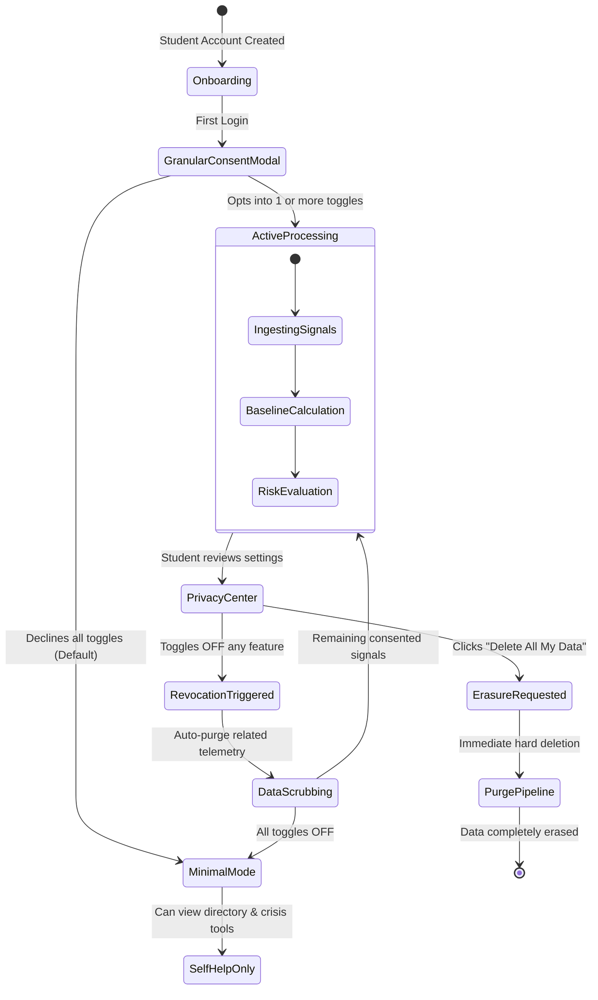

# Privacy, Ethics & Legal Governance Framework
**Project:** S-12: AI-Based Mental Health Support and Crisis Detection (Sahayak)  
**Document Version:** 1.0.0 (Foundational Architecture)  
**Status:** Approved for Engineering Scaffolding  

---

## 1. Regulatory Context & Compliance Architecture

Sahayak is built to operate under the world's most stringent privacy and student rights frameworks, specifically:
- **Digital Personal Data Protection (DPDP) Act 2023 (India):** Establishes the student as a *Data Principal* with unalienable rights to notice, affirmative consent, purpose limitation, data minimization, and immediate right of erasure.
- **Family Educational Rights and Privacy Act (FERPA - US / Global standard in spirit):** Educational records are strictly isolated; behavioral telemetry is never commingled with official academic transcripts or disciplinary files.
- **General Data Protection Regulation (GDPR - EU):** Articles 9 (Special Category Data regarding health) and 22 (Automated individual decision-making) require explicit, unambiguous consent, high safeguards, and human intervention in any triage decision.

> **Notice:** *Formal institutional legal review is mandatory prior to production deployment.*

---

## 2. Comprehensive Data Inventory & Lifecycle

| Data Item | Purpose | Legal Basis / Consent | Retention Limit | Who Can Access | Encryption at Rest |
| :--- | :--- | :--- | :--- | :--- | :--- |
| **Identity Record** (Name, Student ID, Email) | User authentication, account recovery, authorized care outreach. | User Agreement & Explicit Consent | Active enrollment + 30 days post-graduation | Student, Auth Middleware, Counselor (unmasked upon audit log) | AES-256 (Database level) |
| **Pseudonymous Token** (`student_pseudo_id`) | Decoupling identity from health telemetry in analytics and risk engine. | System Security & Pseudonymization | Active enrollment | Internal Services, Risk Engine, Analytics Engine | Hashed HMAC-SHA256 with institutional salt |
| **Survey Responses** (Mood, Stress, Burnout items) | Self-reflection, trend analysis, risk scoring. | Explicit Opt-In Consent (`consent_surveys`) | 90 days rolling window (auto-purged) | Student, Counselor (aggregate summary only) | AES-256 (Database level) |
| **Journal Entries** (Free-form reflections) | Private emotional journaling for student self-care. Decrypted only in memory during active student session. NEVER ingested by risk engine without separate explicit opt-in. | User Personal Utility (`consent_journal`) | Retained until student deletes | **Student ONLY** (Zero Counselor / Zero Admin access) | **AES-256-GCM Field-Level Envelope Encryption** |
| **Academic Drift Signals** (Delays, attendance variance) | Corroborating distress trends vs personal baseline. | Explicit Opt-In Consent (`consent_academic`) | 60 days rolling window | Risk Engine only (numerical derivatives) | AES-256 |
| **Help-Seeking Telemetry** (Booking attempts, resource clicks) | Corroborating urgent need for care. | Explicit Opt-In Consent (`consent_help_seeking`) | 30 days rolling window | Risk Engine only | AES-256 |
| **Risk Tier Evaluations** (Tier 0-3, Confidence, Reasons) | Prioritizing counselor outreach and displaying self-care. | Explicit Consent (`consent_counselor_triage`) | 90 days | Student (own tier), Assigned Counselor | AES-256 |
| **Audit Logs** (Unmasking events, consent changes) | Tamper-evident accountability and compliance verification. | Legal & Compliance Mandate | 365 days immutable retention | University Compliance Officer, Admin | AES-256 + SHA-256 Hash Chained |

---

## 3. Consent Architecture & Lifecycle Flows

### 3.1 Granular Toggles
Consent is never bundled. Each of the following four domains possesses an independent toggle:
1. `CONSENT_SURVEYS` (Default: OFF)
2. `CONSENT_ACADEMIC_SIGNALS` (Default: OFF)
3. `CONSENT_HELP_SEEKING_SIGNALS` (Default: OFF)
4. `CONSENT_COUNSELOR_CHECKIN_QUEUE` (Default: OFF)

### 3.2 Right to Erasure ("Delete My Data" Flow)
When a student clicks "Delete My Data" in their Privacy Center:
1. The student is prompted with an affirmative confirmation dialog explaining the action is irreversible.
2. The server executes a cascade delete across `surveys`, `signals`, `journal_entries`, and `risk_evaluations` matching the student's `student_pseudo_id`.
3. The real identity account record is soft-deleted or removed.
4. An immutable audit log entry is recorded: `ACTION_USER_ERASURE_EXECUTED`, storing only the timestamp and an un-linkable cryptographic receipt.

---

## 4. Threat Model & Security Analysis (STRIDE Summary)

| STRIDE Threat | Potential Vulnerability | Architectural Mitigation |
| :--- | :--- | :--- |
| **Spoofing Identity** | An attacker impersonates a student or counselor to view sensitive logs. | MFA enforced for staff; short-lived signed JWT session cookies with `HttpOnly` and `SameSite=Strict`. |
| **Tampering with Data** | A rogue admin modifies audit logs to hide unauthorized inspection of student files. | Append-only audit log with SHA-256 cryptographic hash chaining (`hash = SHA256(prev_hash + entry_data)`). |
| **Repudiation** | A counselor denies unmasking a student's identity. | Unmasking endpoint mandates an explicit outreach reason and creates an immutable cryptographic audit record. |
| **Information Disclosure** | Student mental health records leaked via SQL injection or unauthorized API call. | Parameterized queries via Prisma ORM; field-level AES-256-GCM encryption on journals; no foreign key joins from identity to telemetry. |
| **Denial of Service** | Malicious actor spams survey or crisis endpoints during exam period. | Sliding-window rate limiting; static edge caching for the Verified Support Directory and Crisis modal. |
| **Elevation of Privilege**| Student alters request payloads to access counselor triage queue. | RBAC verified at Next.js edge middleware and server action function barriers. |

### 4.1 Re-Identification Risk in Small Cohorts ($k$-Anonymity)
In institutional analytics dashboards, an administrator could theoretically deduce which student is in distress if a small department (e.g., 4 students in a niche graduate seminar) shows a sudden stress spike.

**Strict Mitigation:**
All queries for aggregate reporting enforce $k$-anonymity with threshold $k \ge 10$:
- If the selected cohort (e.g., Department $\times$ Academic Year $\times$ Gender) contains fewer than 10 students, the entire metrics card is suppressed and replaced with:  
  *`[Aggregated data suppressed: Cohort size is under the privacy threshold (k >= 10)]`*.

---

## 5. Ethical Review Checklist: "What This System Must NEVER Do"

All engineers and automated agents are bound by this ethical covenant:

1. **NEVER compute or display a clinical diagnosis.**  
   *No DSM/ICD codes, no depression/anxiety diagnoses.*
2. **NEVER share individual student data with faculty, academic advisors, or parents.**  
   *The platform is a firewall between wellbeing and academic administration.*
3. **NEVER use mental health indicators for disciplinary action or academic grading.**  
   *Signals are purely for supportive human check-in triage.*
4. **NEVER execute automated police dispatch or non-consensual emergency calls.**  
   *Crisis options are surfaced to the student directly for self-activation or warm handoff.*
5. **NEVER feed student journals or free-form survey text to un-redacted public AI models.**  
   *Any LLM features must run on anonymized text or locally hosted guard-railed models.*
6. **NEVER incorporate protected demographic attributes into risk scoring.**  
   *Gender, sexual orientation, caste, race, nationality, and religion are strictly forbidden as model inputs.*
7. **NEVER implement coercive or gamified retention loops.**  
   *No guilt-tripping notifications ("You missed your check-in!"), streaks, or leaderboards.*

---

## 6. Incident Response & Data Breach Protocol

In the event of suspected unauthorized access or data exposure:

1. **Containment (Hour 0 - 2):**
   - Automatically revoke active counselor sessions and rotate the `APP_MASTER_ENCRYPTION_KEY` and `PSEUDO_SALT_SECRET`.
   - Isolate compromised database instances to read-only mode.
2. **Investigation & Triage (Hour 2 - 12):**
   - Inspect the tamper-evident audit log chain to verify whether hash consistency has been broken and identify affected records.
   - Determine if any field-level encrypted journal payloads were accessed.
3. **Notification & Transparency (Hour 12 - 48):**
   - If personal data was breached, notify institutional leadership and data protection authorities per DPDP Act / GDPR statutory timelines.
   - Provide direct, plain-language notification to affected students with concrete steps taken and support resources.
4. **Post-Mortem & Remediation (Day 3 - 7):**
   - Publish an internal security review, patch identified vulnerabilities, and update test suites with automated regression checks.

