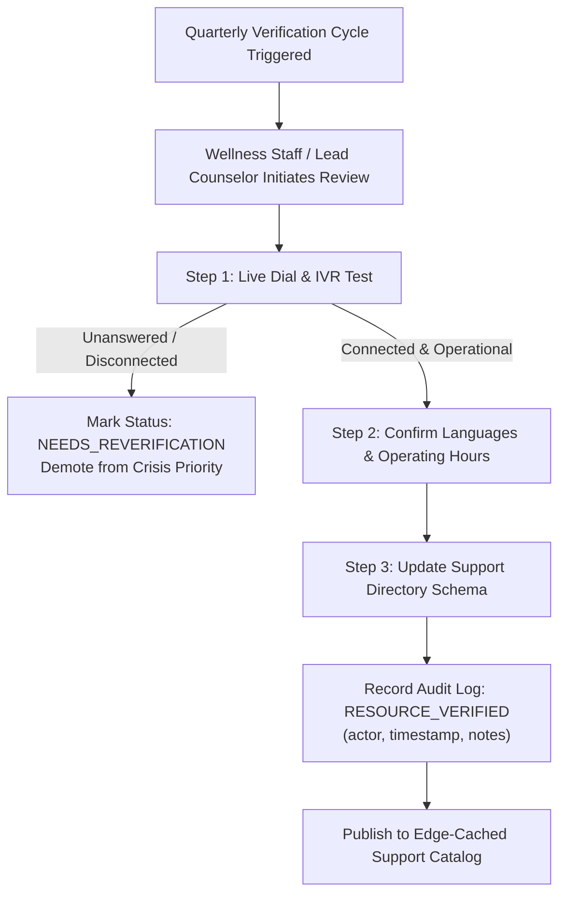

# Verified Support Directory & Crisis Escalation Architecture

**Project:** S-12: AI-Based Mental Health Support and Crisis Detection (Sahayak)  
**Document Version:** 1.0.0 (Foundational Architecture)  
**Status:** Approved for Engineering Scaffolding

---

## 1. Directory Mission & Verification Governance

A mental health crisis tool that surfaces out-of-date, disconnected, or unverified phone numbers poses an immediate risk to human life. In crisis states, encountering a dead dial tone or unanswered ring exacerbates feelings of isolation and despair.

### Non-Negotiable Support Principles:

1. **Never Invent or Guess Numbers:** Every number included in Sahayak must be cross-referenced with public government registries or verified institutional directories.
2. **Explicit Verification Lifecycle:** Every entry maintains an immutable verification record: who verified it, when it was last dialed/tested, its verified operational hours, and when the next manual verification is due (maximum 90-day cycle).
3. **Region-Configurable:** Campuses operate in diverse legal and telecommunication environments (India, USA, UK, Global). Directory items are filtered based on campus configuration and student geolocation preferences.
4. **Zero-Barrier Access:** Crisis resources are exposed via public, edge-cached endpoints requiring zero login, session cookies, or device permissions.

---

## 2. Resource Schema & Data Contract

```typescript
export interface VerifiedSupportResource {
  id: string;
  name: string;
  category:
    | 'CAMPUS_COUNSELING'
    | 'NATIONAL_HELPLINE'
    | 'EMERGENCY_SERVICES'
    | 'PEER_SUPPORT'
    | 'SPECIALIZED';
  description: string;
  phone: string; // Canonical E.164 or national shortcode format
  sms_or_whatsapp?: string; // Text/chat channel if available
  web_url: string; // Official authoritative portal
  operating_hours: string; // e.g., "24/7/365", "Mon-Fri 09:00 - 18:00 IST"
  languages_supported: string[]; // e.g., ["English", "Hindi", "Bengali", "Marathi"]
  region_code: string; // ISO 3166-1 alpha-2 / State / Campus (e.g., "IN", "IN-MH", "CAMPUS-CENTRAL")
  is_free_toll_free: boolean;
  is_crisis_priority: boolean; // Displayed in top banner during Tier 3 / Crisis Modal
  verification_status: 'VERIFIED' | 'NEEDS_REVERIFICATION' | 'PENDING_INITIAL_CHECK';
  verified_by: string; // Full Name & Staff Role (e.g., "Dr. Vikram Malhotra, Lead Counselor")
  verified_on: string; // ISO Date: YYYY-MM-DD
  next_verification_due: string; // ISO Date: YYYY-MM-DD
  verification_notes: string; // Notes from dial test (e.g., "Answered within 3 rings by live operator")
}
```

---

## 3. Mandatory Verification Workflow



### Verification Rules:

- **Maximum Review Window:** 90 calendar days. If `next_verification_due` expires without re-verification, the administrative dashboard flags a critical alert, and the entry displays a gentle warning: _"Listing overdue for routine verification"_.
- **Live Dial Protocol:** Staff must dial the number, listen through the IVR, confirm language availability, and log the time to live counselor response.

---

## 4. Pre-Configured Seed Resources

> ⚠️ **CRITICAL PRE-LAUNCH NOTICE:**  
> All national helpline entries below reflect official published government and NGO resources for India (primary reference deployment) and international standards. **Each entry must be formally verified by institutional staff before production activation.**

| ID & Resource Name                                                        | Type                       | Verified Number / Channel                              | Languages                             | Operating Hours       |     Region     | Verification Flag      |
| :------------------------------------------------------------------------ | :------------------------- | :----------------------------------------------------- | :------------------------------------ | :-------------------- | :------------: | :--------------------- |
| **Tele-MANAS** (National Tele Mental Health Programme of India)           | National Helpline          | **14416** / **1800-891-4416** (Toll-Free)              | English, Hindi, Bengali, +17 Regional | 24/7                  |      `IN`      | `VERIFY BEFORE LAUNCH` |
| **KIRAN Mental Health Helpline** (Ministry of Social Justice, India)      | National Helpline          | **1800-599-0019** (Toll-Free)                          | English, Hindi, Bengali, +10 Regional | 24/7                  |      `IN`      | `VERIFY BEFORE LAUNCH` |
| **Vandrevala Foundation**                                                 | NGO Crisis Helpline        | **+91 9999 666 555**                                   | English, Hindi, Gujarati, Marathi     | 24/7                  |      `IN`      | `VERIFY BEFORE LAUNCH` |
| **National Emergency Services (India)**                                   | Emergency Medical & Police | **112** (Universal Emergency)                          | Multilingual                          | 24/7                  |      `IN`      | `VERIFY BEFORE LAUNCH` |
| **Campus Wellbeing Center (Primary Desk)**                                | Campus Counseling          | _Institutional Extension: [Campus Phone Placeholder]_  | English, Hindi                        | Mon-Sat 08:00 - 20:00 | `CAMPUS-MAIN`  | `VERIFY BEFORE LAUNCH` |
| **Campus After-Hours Crisis Responder**                                   | On-Call Care               | _On-Call Duty Cell: [Emergency Duty Cell Placeholder]_ | English, Hindi                        | 20:00 - 08:00         | `CAMPUS-MAIN`  | `VERIFY BEFORE LAUNCH` |
| **988 Suicide & Crisis Lifeline** (US Reference / International Exchange) | International Reference    | **988** (US Dial / SMS)                                | English, Spanish                      | 24/7                  |      `US`      | `VERIFY BEFORE LAUNCH` |
| **Crisis Text Line**                                                      | Text-Based Support         | Text **HOME to 741741** (US/UK/CA)                     | English, Spanish                      | 24/7                  | `US`/`UK`/`CA` | `VERIFY BEFORE LAUNCH` |

---

## 5. Instant-Access Crisis Screen Implementation & Snapshot Architecture

### 5.1 Zero-DB Static Snapshot Pipeline

To ensure phone numbers are never hardcoded in source code while guaranteeing zero-delay, zero-DB-dependency delivery during an emergency, Sahayak employs a static snapshot architecture:

```
[Verified Support Directory (DB/Admin CMS)]
                  │
                  ▼  npm run generate:support-snapshot
[Static JSON Snapshot (src/data/support-snapshot.json)]
                  │
                  ▼  CI Gate: npm run verify:support-snapshot (Fails if stale or unverified)
[Edge-Rendered /crisis Page (Zero Auth, Zero DB Call)]
```

1. **Single Source of Truth:** All listings are managed and validated in the database directory.
2. **Build-Time Generation:** The script `scripts/generate-support-snapshot.ts` queries the verified directory and writes `src/data/support-snapshot.json`.
3. **Automated CI Freshness Check:** The CI pipeline runs `scripts/verify-support-snapshot.ts` before every build. The build fails if:
   - The snapshot is missing or out of sync with the directory.
   - Any entry in the snapshot has a missing or empty `verified_on` date.
   - Any entry has `verification_status !== 'VERIFIED'`.
4. **Runtime Delivery:** `/crisis` imports `src/data/support-snapshot.json` directly as a static data file. It does not query PostgreSQL, avoiding any database connection overhead, cold-start delay, or outage failure.

### 5.2 Route: `/crisis`

- **Zero Authentication Barrier:** Unauthenticated access allowed in Next.js middleware.
- **Immediate Visual Layout:**
  1. **Demo Placeholder Banner:** A prominent amber banner: _"Notice: Demo placeholders. Contact details must be institutional-verified prior to live launch."_
  2. **Top Emergency Bar:** High-contrast call buttons for Tele-MANAS (`14416`), KIRAN (`1800-599-0019`), and Campus Emergency (`112`).
  3. **One-Tap Dialing:** Native `tel:` URI links rendered as large, accessible touch targets ($56\text{px}$ height).
  4. **Interactive Grounding Widget:** An animated deep-breathing visualizer ("Inhale for 4 seconds, Hold for 4, Exhale for 6") to help de-escalate physiological panic before dialing.
  5. **Confidentiality Reassurance:** Explicit disclaimer stating: _"Accessing this screen is private. No records of this visit are shared with professors, deans, or academic records."_

### 5.3 Automatic Warm Handoff Modal (Triggered by Acute Survey Responses)

When an acute distress signal is detected in a voluntary check-in:

```
+----------------------------------------------------------------------------------+
|                           WE ARE HERE WITH YOU                                   |
+----------------------------------------------------------------------------------+
| It sounds like things feel really overwhelming right now. You do not have        |
| to navigate this alone. Please connect with someone who can support you:         |
|                                                                                  |
|  [ Call Tele-MANAS (24/7 Free: 14416) ]                                          |
|                                                                                  |
|  [ Call Campus Counselor on Duty ]                                               |
|                                                                                  |
|  [ Continue to Grounding Exercises ]                                             |
|                                                                                  |
| Your safety matters. Seeking support is confidential and has zero impact on      |
| your academic standing.                                                          |
+----------------------------------------------------------------------------------+
```
